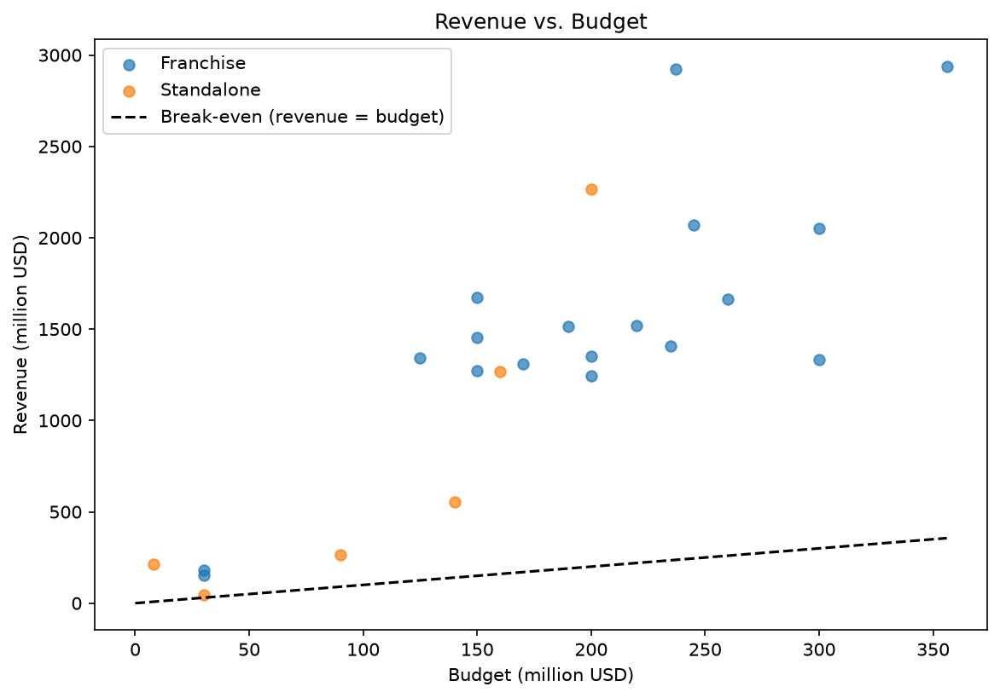
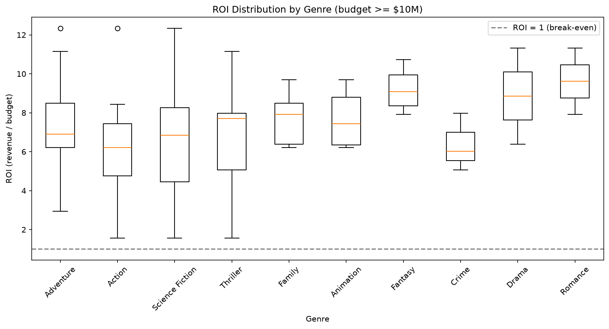
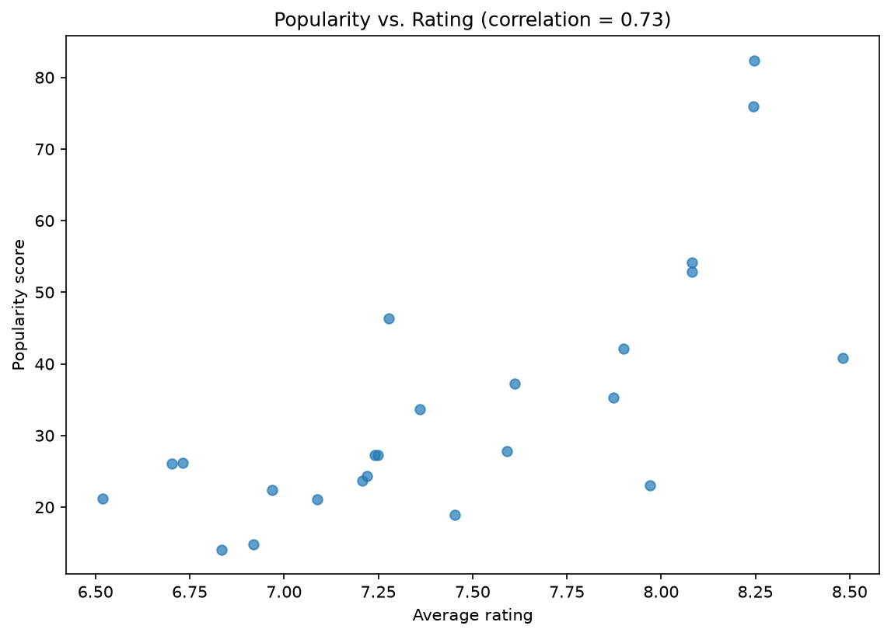
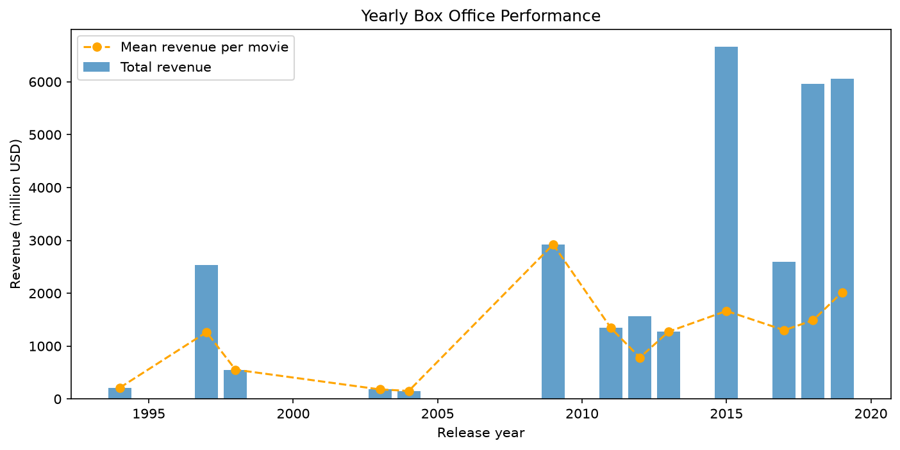
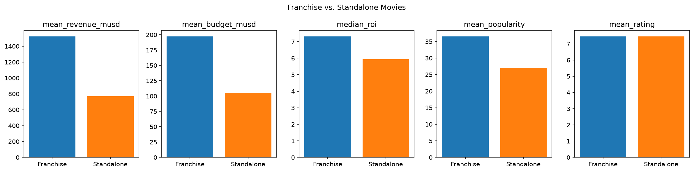

# TMDB Movie Data Analysis

A data pipeline that fetches movie data from the [TMDB API](https://developer.themoviedb.org/docs), cleans it with Pandas, explores it, calculates financial and popularity KPIs, compares franchise and standalone movies, and presents the findings with Matplotlib charts.

Built for the AmaliTech Data Engineering Apprenticeship by **Dushimimana Prince**.

---

## Tools

| Tool | What it is used for |
|---|---|
| **Python** | The language for the whole pipeline |
| **Requests** | Calling the TMDB REST API |
| **Pandas** | Cleaning, transforming and analysing the data |
| **NumPy** | Handling missing values (`NaN`) and conditional columns |
| **Matplotlib** | Drawing the five charts |
| **python-dotenv** | Loading the API key from a `.env` file so it is never written in the code |
| **Jupyter Notebook** | Running each step in order and explaining the results |
| **Git & GitHub** | Version control, with one commit per change |

---

## Project structure

```
TMDB-Movie-Data-Analysis/
├── notebooks/
│   └── tmdb_analysis.ipynb     # Runs every step in order and explains the results
├── src/tmdb_analysis/          # Reusable code, imported by the notebook
│   ├── config.py               # File paths, movie IDs and API settings
│   ├── api_client.py           # Fetches movies from TMDB (timeout, retries, error handling, cache)
│   ├── cleaning.py             # Every cleaning step, one function per step
│   ├── eda.py                  # Missing values, summary statistics, outliers
│   ├── kpis.py                 # Profit, ROI and the 10 KPI rankings
│   ├── analysis.py             # Searches, franchise vs standalone, top franchises and directors
│   └── visualization.py        # The five charts
├── reports/figures/            # Charts saved by the notebook
├── data/                       # Raw API data and clean CSV (created when you run it; not committed)
├── requirements.txt            # Dependencies with exact versions
├── .env.example                # Template for the API key
└── .gitignore                  # Keeps .env and data/ out of Git
```

**Why this structure?** The notebook tells the story and shows the results, while the logic lives in small Python files. Each function does one job and has a docstring, so it can be reused, read on its own and changed in one place.

---

## How to run

**1. Clone the project and install the dependencies**

```bash
git clone https://github.com/Dushimimanaprince/TMDB-Movie-Data-Analysis.git
cd TMDB-Movie-Data-Analysis
pip install -r requirements.txt
```

**2. Add your API key**

Get a free key from [TMDB](https://www.themoviedb.org/settings/api), then copy the template:

```bash
cp .env.example .env
```

Open `.env` and replace `your_tmdb_api_key_here` with your key. `.env` is listed in `.gitignore`, so your key is never committed.

**3. Run the notebook**

```bash
jupyter notebook notebooks/tmdb_analysis.ipynb
```

Choose **Kernel → Restart & Run All**.

- The first run calls the API and saves the raw data to `data/raw/movies_raw.json`.
- Later runs read that file, so they are fast and work offline. Use `load_movies(refresh=True)` to fetch fresh data.
- The clean dataset is saved to `data/processed/tmdb_movies_clean.csv` and the charts to `reports/figures/`.

---

## The data

The brief gives 19 movie IDs. ID `0` does not exist on purpose: it tests that the code handles a "not found" error. That leaves **18 lab movies**.

None of the lab movies star Bruce Willis or are directed by Quentin Tarantino, so the two required search queries would always return empty results. Six extra movies are added so the searches can be demonstrated: The Fifth Element, Armageddon, Looper, Pulp Fiction, Kill Bill: Vol. 1 and Kill Bill: Vol. 2. They are kept in a separate, labelled list (`SEARCH_MOVIE_IDS` in `config.py`).

**Final dataset: 24 movies, 22 columns.**

---

## What the project does

### Phase 1: Extraction (`api_client.py`)

Each movie is requested from `/movie/{id}?append_to_response=credits`, which returns the movie details **and** its cast and crew in a single request.

| Situation | What the code does |
|---|---|
| Success (200) | Keeps the movie |
| Movie not found (404) | Skips it and prints a message (this is what happens to ID `0`) |
| Wrong API key (401) | Stops the run, because every other request would fail too |
| Rate limit (429) or server error (5xx) | Waits and retries, up to 3 times |
| No response | Gives up after a 10-second timeout and retries |

The API key is passed as a parameter, not written into the URL, so it never appears in printed messages. The raw responses are saved to `data/raw/` so the analysis always starts from the same data.

### Phase 2: Cleaning (`cleaning.py`)

The steps run in this order:

1. **Drop unused columns:** `adult`, `imdb_id`, `original_title`, `video`, `homepage`.
2. **Flatten nested JSON:** lists such as `genres` become text like `Action|Adventure`; the collection becomes its name; `credits` becomes `cast`, `cast_size`, `director` and `crew_size`. Empty values become `NaN` (not an empty string), so they count as missing.
3. **Inspect the new columns** with `value_counts()`.
4. **Fix data types:** numbers become numeric and `release_date` becomes a date. Values that can't be converted become `NaN`.
5. **Replace unrealistic zeros:** a budget, revenue or runtime of `0` means "unknown", so it becomes `NaN`.
6. **Convert to millions:** create `budget_musd` and `revenue_musd`. This runs **after** step 5 on purpose. If it ran first, an unknown budget would become `0.0`, which makes ROI infinite and profit equal to the whole revenue.
7. **Zero votes:** a `vote_average` with `vote_count = 0` is not a real rating, so it becomes `NaN`.
8. **Placeholder text:** values like `"No Data"` in `overview` and `tagline` become `NaN`.
9. **Remove bad rows:** duplicates, rows without `id` or `title`, rows with fewer than 10 non-missing values, and movies that are not `Released`.
10. **Final order:** put the columns in the order required by the brief and reset the index.

A **validation cell** then checks these rules on the final data: correct column order, unique IDs, no zeros left in the money columns, no rating without votes, and at least 10 values per row. All checks pass.

### Phase 3: Exploratory data analysis (`eda.py`)

- **Missing values:** only `belongs_to_collection` has gaps (6 movies, 25%). This is expected: it simply means those movies are standalone.
- **Summary statistics:** `describe()` on every number column. The mean budget is $174M and the mean revenue $1,334M.
- **Outliers:** found with the IQR rule. The standard deviation is not used because a few huge hits would hide the outliers.
  - Revenue: Avengers: Endgame and Avatar (very high), Kill Bill: Vol. 2 and Looper (very low)
  - Popularity: Avengers: Endgame and Avengers: Infinity War
  - Runtime: Titanic (194 minutes)
  - These are real movies, not errors, so they are kept.

### Phase 4: KPIs and analysis (`kpis.py`, `analysis.py`)

**Profit** = revenue − budget. **ROI** = revenue ÷ budget.

All 10 rankings use one function, `rank_movies()`:

| KPI | Top result | Filter |
|---|---|---|
| Highest Revenue | Avengers: Endgame ($2,939M) | — |
| Highest Budget | Avengers: Endgame ($356M) | — |
| Highest Profit | Avatar ($2,687M) | — |
| Lowest Profit | Looper ($17M) | — |
| Highest ROI | Avatar (12.3×) | budget ≥ $10M |
| Lowest ROI | Looper (1.6×) | budget ≥ $10M |
| Most Voted | The Avengers (40,123 votes) | — |
| Highest Rated | Pulp Fiction (8.48) | ≥ 10 votes |
| Lowest Rated | Jurassic World: Fallen Kingdom (6.52) | ≥ 10 votes |
| Most Popular | Avengers: Endgame (82.4) | — |

The filters stop a very cheap movie from topping the ROI ranking by chance, and a movie with only a few votes from topping the rating ranking.

**Search queries.** Searches split the pipe-separated text into a list and compare whole names, so "Bruce Willis" cannot match a longer name and a movie must have *both* genres.

| Search | Result |
|---|---|
| Science Fiction Action movies with Bruce Willis (best rated first) | The Fifth Element (7.59), Looper (6.92), Armageddon (6.84) |
| Uma Thurman movies directed by Quentin Tarantino (shortest first) | Kill Bill: Vol. 1 (111 min), Kill Bill: Vol. 2 (136 min), Pulp Fiction (154 min) |

**Franchise vs. standalone.** A movie is a franchise movie if it belongs to a collection.

| | Movies | Mean revenue | Median ROI | Mean budget | Mean popularity | Mean rating |
|---|---|---|---|---|---|---|
| Franchise | 18 | $1,522M | 7.31× | $197M | 36.5 | 7.45 |
| Standalone | 6 | $768M | 5.93× | $105M | 27.0 | 7.45 |

The median is used for ROI because one cheap hit can pull the mean far above a typical movie.

**Top franchises and directors.** Both are ranked by total revenue. The Avengers Collection is the most successful franchise in the sample (4 movies). James Cameron is the top director ($5,188M from 2 movies), followed by Joe and Anthony Russo ($4,991M from 2 movies, with the highest mean rating of 8.25). A co-directed movie counts for each director.

### Phase 5: Visualisation (`visualization.py`)

Five charts made with Matplotlib, explained in the next section.

---

## Charts and insights

### 1. Revenue vs. budget



Each dot is a movie: blue for franchise, orange for standalone. The dashed line is **break-even**, where revenue equals budget.

- **Every movie is above the break-even line**, so all 24 made back their budget.
- Franchise movies cluster at high budgets ($125M–$355M) and high revenues ($1,250M–$2,940M).
- Standalone movies are spread out: mostly lower budgets and revenues, with Titanic as the clear exception (about $2,264M from $200M).
- Bigger budgets generally bring bigger revenue, but the spread is wide: movies with similar budgets earn very different amounts.

### 2. ROI distribution by genre



Each box shows the spread of ROI for one genre (movies with a budget of at least $10M, genres with at least 2 movies). The orange line in each box is the median. A movie with several genres appears in several boxes.

- **Romance (≈9.6×), Fantasy (≈9.1×) and Drama (≈8.9×)** have the highest median ROI, but they are based on only a few movies each, so these results are less reliable.
- **Crime (≈6.0×) and Action (≈6.2×)** have the lowest medians.
- Action, Adventure and Science Fiction have the widest boxes: they contain both the best and some of the weakest returns.
- Every genre stays well above ROI = 1 (the dashed line).

### 3. Popularity vs. rating



Each dot is a movie. The correlation in the title measures how closely the two move together.

- The correlation is **0.73, a strong positive relationship**: better-rated movies tend to be more popular.
- Avengers: Endgame and Avengers: Infinity War are top-right, high on both.
- The highest-rated movie (Pulp Fiction, 8.48) has only moderate popularity (about 41). TMDB popularity reflects *current* activity, so an older classic can be highly rated without being among the most popular today.

### 4. Yearly box office performance



The bars show **total** revenue per release year; the line shows the **average** revenue per movie that year.

- **2015 has the highest total (about $6,600M)** because several movies in the sample were released that year, not because each one earned the most.
- **2009 has the highest average (about $2,900M)**: the bar and the line meet because only one movie, Avatar, was released that year.
- 1997 stands out thanks to Titanic.
- Since the bars depend on how many sampled movies came out each year, the line is the better guide to how well individual movies performed.

### 5. Franchise vs. standalone



Each small chart compares the two groups on one metric. They are drawn separately because revenue (hundreds of millions) and rating (0–10) cannot share one axis.

- Franchise movies earn **about twice the revenue** ($1,522M vs $768M) but also cost **almost twice as much** ($197M vs $105M).
- Even after the higher cost, franchises have a **better median ROI** (7.31× vs 5.93×) and **higher popularity** (36.5 vs 27.0).
- **Both groups have exactly the same mean rating (7.45)**: franchises make more money without being rated better by audiences.

---

## Conclusions

1. **Franchises dominate the box office.** They earn more, return more per dollar and are more popular, but audiences do not rate them higher.
2. **Big budgets bring big revenue, not always the best return.** Avatar has both the highest profit and the highest ROI, but cheaper films like Looper show the weakest returns.
3. **Popularity and rating are strongly linked (r = 0.73),** with older classics as the main exception.
4. **Small groups need care.** Genres such as Romance and Drama, and the standalone group (6 movies), rest on few movies, so one title can change their results.

**Limitation:** the sample is 24 hand-picked, mostly record-breaking movies, so these results describe the top of the box office rather than movies in general. A next step would be to fetch a larger, random set of released movies with TMDB's `/discover/movie` endpoint and adjust money values for inflation.

---

## Improvements after code review

| Review comment | What was changed |
|---|---|
| Only 4 of 10 KPIs | All 10 KPIs implemented with one `rank_movies()` function |
| No EDA | Added missing values, summary statistics and outlier detection |
| No written insights | Every section and chart now has written observations |
| No README, no structure | Added this README and split the code into modules in `src/` |
| Budget converted to millions before zeros became `NaN` | Fixed the order; a validation cell confirms no zeros remain |
| seaborn missing from `requirements.txt`, versions not pinned | Removed seaborn (Matplotlib only, as the brief says) and pinned all versions |
| Notebook not run top to bottom | Rebuilt so it runs cleanly with Restart & Run All |
| API client had no timeout, retry or 404 handling | Added a timeout, retries and separate handling for 404 and 401 |

For a summary of the findings, see [REPORT.md](REPORT.md).